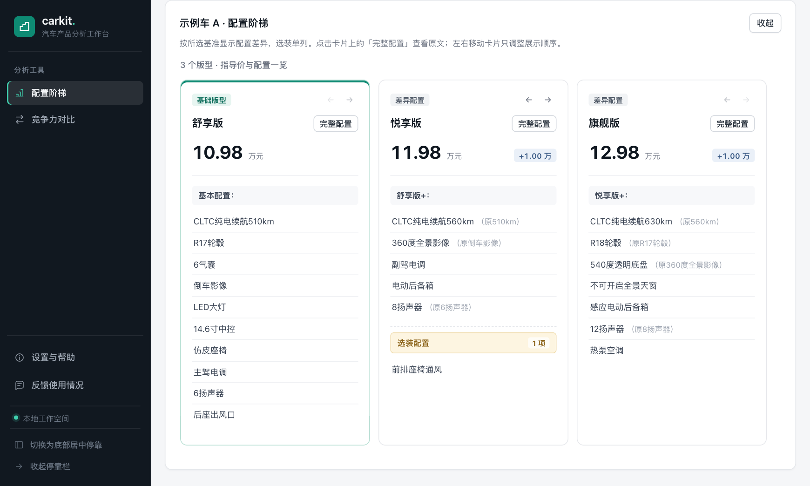
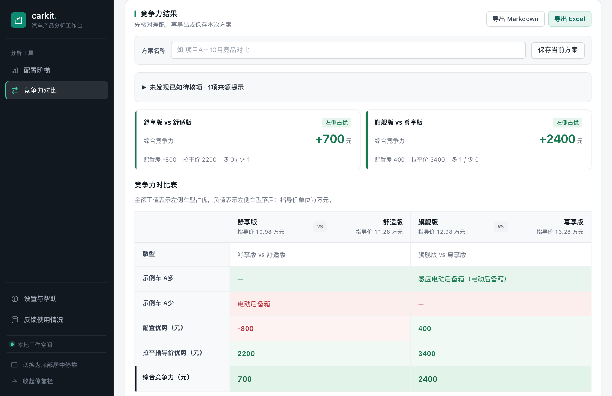
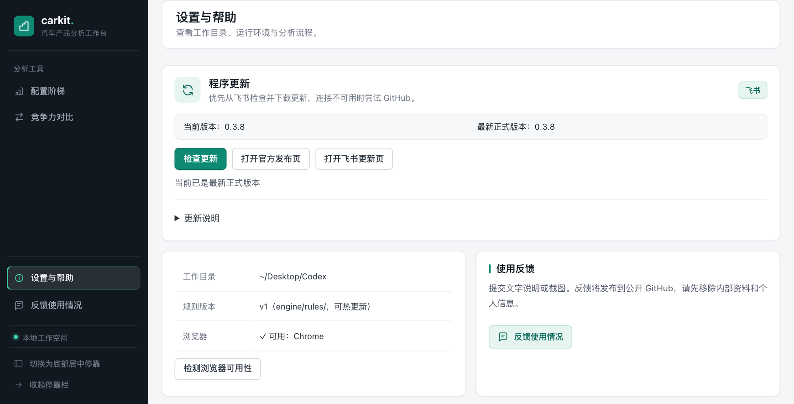

# Carkit · 汽车产品分析工作台

[下载最新版（GitHub）](https://github.com/a18012239736-rgb/carkit/releases/latest) · [飞书下载与更新说明](https://my.feishu.cn/wiki/RbVTwWOJFiCjOukyBO8csx2Rnwd) · [反馈问题](https://github.com/a18012239736-rgb/carkit/issues)

## 关于 Carkit

Carkit 是一款面向汽车产品、竞品和上市分析的桌面工具。做单车分析时，可以从汽车之家读取一款车的配置，看各个版型相对基准多了什么、少了什么。做竞品对比时，可以导入自己的产品配置，手动选出要比的两款版型，按同一套规则把配置差异折算成金额。结果可以导出成 Excel 或 Markdown，也可以保存成方案，下次接着做。

工作数据默认保存在本机。程序里的版本号、工作目录、检查更新和反馈入口都在「设置与帮助」。下面的车型、配置、价格和更新状态均为界面示例。

## 下载与安装

打开 [GitHub 最新发布页](https://github.com/a18012239736-rgb/carkit/releases/latest)，在 **Assets（附件）** 中选对应文件。GitHub 连不上时，可以从 [飞书更新页](https://my.feishu.cn/wiki/RbVTwWOJFiCjOukyBO8csx2Rnwd) 下载。`<版本>` 在文件名里会换成实际版本号。

| 你的电脑 | 选哪个文件 | 怎么打开 |
| --- | --- | --- |
| Windows x64，日常使用 | `carkit-<版本>-setup.exe` | 双击安装。之后可以在程序里下载并安装新版。 |
| Windows x64，免安装 | `carkit-<版本>.exe` 或 `carkit.exe` | 双击运行。两种文件名对应同一个便携包。 |
| Mac，Apple 芯片（M 系列） | `carkit-<版本>-macos-arm64.dmg` | 打开 DMG，把 `carkit.app` 拖到「应用程序」。 |

安装包可直接使用，无需另装 Python。Windows 界面依赖 **WebView2 Runtime**。读取汽车之家配置需要 Edge 或 Chrome，可以在「设置与帮助」点击「检测浏览器可用性」。Mac 可通过「 → 关于本机」确认芯片类型，目前提供 Apple 芯片版，安装包尚未经过 Apple 公证。

## 配置阶梯 · 看同一款车的高低配差异



1. 在「配置阶梯」输入车型名或汽车之家配置页网址，点击「搜索车型」。出现「选择抓取条件」时，按需选年款等条件，再点「开始抓取」。已读取过的车型可以从「打开历史车型」找回。
2. 在「确认版型与比较基准」中勾选要输出的版型，选择「基本版型」，再给其他版型指定基准。多个版型可以共用同一个基准，也可以各自选择参照。
3. 点击「查看配置阶梯图」，查看指导价、相对基准的价差和配置变化。卡片上的「完整配置」可以展开本版型的配置，选装在卡片下方单列。需要发给同事时，可导出 Markdown 或 Excel。

版型太多时，可以拖动「左右查看」滑杆，或用卡片上的箭头调整显示顺序。想改变导出的比较关系，请回到版型设置调整基准。

想精简结果时，展开「不展示的配置」，**勾选要隐藏的配置**，点击「保存不展示清单」，再打开阶梯图或重新导出。这份清单应用于同一工作目录内各车型的阶梯图和导出。原始配置、竞争力赋值和已导出的文件保留原状。

## 竞争力对比 · 算两款车差多少钱



「本品」是你正在评估的车，「竞品」是用来作参照的车。已有两款竞品时，也可以直接互比。

1. **准备车型。** 先在「配置阶梯」读取竞品。自己的车型可在「竞争力对比 → 本品配置」导入 PPT，也可手动录入。导入时选中配置阶梯页，点击「解析这一页」，核对版型、价格和继承关系，展开完整配置确认后保存。指导价以万元填写，例如 `11.98`。待确定的价格和 TP 价格需要先核对口径。选装可在版型配置中每行填写一项，单独展示，不参与赋值。
2. **配对版型。** 回到「对比」页签，选「本品 vs 竞品」或「竞品 vs 竞品」。左侧是要评估的车，右侧是参照。只挑实际需要比较的版型，想同时算多组时点「添加配对组」。
3. **填实际比较的底价。** 两侧底价按同一口径填写，单位是元，例如 `110000`。底价可留空。此时可以看配置优势，双方指导价都填好时也可以看拉平指导价优势。
4. **核对并交付。** 点击「开始对比」，查看顶部结论和对比表。「待核清单」会提示需要补充的项目。「配置项判定明细 → 查看依据」可核对原文、识别值、标配或选装、人工修正及计算规则。你可以修正配置后重算，或把结果导出成 Markdown 或 Excel。
5. **下次继续。** 点「保存当前方案」保留配置、配对、价格、规则和结果。下次用「打开已保存方案」载入工作副本后继续改或另存。

### 怎么读这三个金额

正数表示左侧占优，负数表示右侧占优。以上图第一组为例，左侧少了 800 元的配置价值，指导价便宜 3,000 元，填入的底价便宜 1,500 元。

| 指标 | 怎么理解 | 示例 |
| --- | --- | ---: |
| 配置优势 | 左侧的配置价值比右侧多或少多少 | −800 元 |
| 拉平指导价优势 | 配置优势 + 右侧指导价 − 左侧指导价 | 2,200 元 |
| 综合竞争力（拉平底价优势） | 配置优势 + 右侧底价 − 左侧底价 | 700 元 |

这三个金额用来分析配置和价格差异。比较前，请确认两侧价格的统计口径一致。选装和 `[待定]` 配置不会当作标配计价。未识别、数量不明或缺少规则的项目可先到「待核清单」核对。

### 如何改计价规则

进入「竞争力对比 → 赋值规则」，修改某项配置的金额或计价档位，点「保存并立即应用」后再重算。也可以从 Excel 或 JSON 导入规则、导出规则 Excel，或恢复内置默认值。

例如，默认普通电动后备箱计 800 元，标配感应功能额外计 400 元，位置记忆不另加价。对比时以当时使用的规则和确认过的配置为准。

## 检查更新



程序启动时会检查更新。飞书是首选更新渠道，飞书连接不可用时会尝试 GitHub。也可以到「设置与帮助 → 程序更新」点「检查更新」。出现更高版本号的正式版才会提示升级。展开「更新说明」可看这一版改了什么。

- **Windows 安装版**：保存工作后点「下载并安装」。程序校验发布清单和安装包，完成安装后会用原工作目录重新打开。
- **Windows 便携版**：点「下载新版」，保存工作并退出旧版，再打开新版 EXE。
- **Apple 芯片 Mac**：下载后点「打开安装包」，退出旧版，再把新版拖到「应用程序」替换。
- **更新入口连不上**：点「打开飞书更新页」或「打开官方发布页」，手动下载对应安装包。

点击「忽略此版本」可关闭当前版本的提醒。更高版本发布后会再次提示，你也可以在更新设置中点「恢复提醒」。版本历史见 [GitHub Releases](https://github.com/a18012239736-rgb/carkit/releases)，当前界面更新见 [v0.3.8 说明](docs/release-v0.3.8.md)。

## 备份、恢复与反馈

- **换电脑或重装**：在「设置与帮助」找到工作目录，备份整个文件夹。默认位置为桌面上的 `Codex` 文件夹。原始配置在 `raw/`，本品快照在 `快照/`，计价规则在 `赋值/`，保存的对比在 `方案/`，分析结果在 `结果/`。
- **误删车型或本品**：在工作目录的 `回收站/` 查找对应文件，将它移回原目录并刷新列表。
- **汽车之家要求验证**：在程序打开的浏览器里完成验证，等配置表加载出来，再回到程序点击「验证后继续读取」。
- **Windows 启动出现白屏**：先确认 WebView2 Runtime 已安装。便携版提示缺少运行文件时，可重新下载最新版单文件 EXE，或改用安装版。
- **反馈问题**：在导航栏或「设置与帮助」点「反馈使用情况」，填写复现步骤、预期和实际结果，可附 PNG 或 JPEG 截图。点「准备反馈并前往GitHub」后，在打开的页面核对文字、上传附件并提交。GitHub Issues 公开可见，提交前请移除内部资料和个人信息。

## 从源码运行

使用 Python 3.12，前端回归检查还需要 Node.js。安装依赖后，可从源码打开程序或运行测试。

```sh
python -m pip install -e ".[gui,scrape,dev]"
python app.py
python -m pytest tests -q
```

打包细节见 [Windows 构建指南](docs/windows-dev.md)。GitHub Actions 提供 Windows 和 Apple 芯片 Mac 的发布构建任务。
