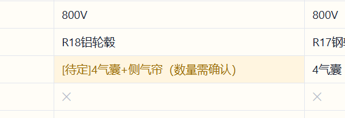
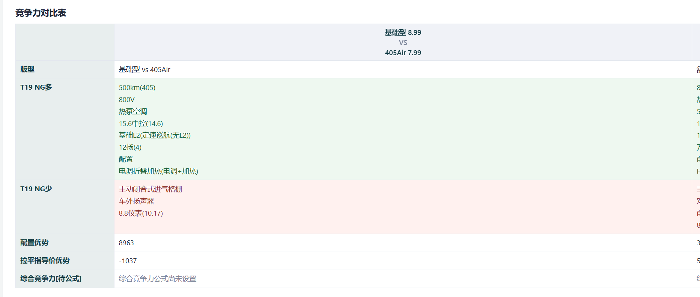

# carkit · 汽车产品分析工作台

carkit 用于整理车型配置阶梯和比较产品竞争力。可以从汽车之家读取车型配置，按版型整理差异，也可以导入本品配置，与历史竞品逐项核对并计算配置优势。

## 下载与启动

**Windows x64** · [GitHub 发布页与更新日志](https://github.com/a18012239736-rgb/carkit/releases/latest)

从 v0.3.2 起，下载发布页的 `carkit-<版本>-setup.exe` 安装，之后可以从程序内安装更新。之前直接运行 EXE 的同事，安装一次即可切换到这条流程。也可下载[单文件便携版](https://github.com/a18012239736-rgb/carkit/releases/latest/download/carkit.exe)，双击运行。

界面需要 WebView2 Runtime，读取汽车之家配置需要 Edge 或 Chrome。Python 和程序运行文件已打包。

程序默认使用桌面上的 `Codex` 文件夹保存车型、规则、方案和结果。可以在「设置与帮助」查看实际工作目录。

## 检查与下载更新

1. 程序启动后优先检查 GitHub 最新正式发布。也可以在「设置与帮助 → 程序更新」点击「检查更新」，查看版本和更新说明。
2. 发布版本高于当前版本时才提示更新。安装版先验证发布清单的签名，再校验安装包的文件大小和 SHA-256。保存工作后，点击「下载并安装」并确认。安装结束后，程序按原工作目录重新打开。
3. 如果 GitHub 检查或下载失败，点击「打开飞书更新页」，使用有访问权限的公司飞书账号下载最新版安装包。手动安装后，若曾自定义工作目录，可沿用原启动参数。
4. 便携版可以在程序内下载并校验新版 EXE。下载后关闭旧版，再运行新版。

GitHub 与飞书提供同一个 Windows 程序，飞书备用入口随程序提供。较早的版本如果没有更新入口，先从 GitHub 发布页或公司飞书更新文档下载一次新版即可。

### 近期更新

- 程序更新卡片集中展示当前版本、更新渠道和可用操作。GitHub 无法检查或下载时，界面会突出显示飞书备用入口。
- 飞书备用入口已设为公司更新文档，拿到 EXE 后即可使用。
- 配置阶梯页面已移除本地 HTML／原始 JSON 导入入口。请通过在线读取或「打开历史车型」继续工作。
- 可在侧栏或设置页打开「反馈使用情况」，整理文字说明和截图。

[查看 v0.3.2 更新记录](docs/release-v0.3.2.md) · [v0.3.1 更新记录](docs/release-v0.3.1.md)

## 配置阶梯

1. 打开「配置阶梯」，输入车型名称、车系编号或汽车之家配置页网址，点击「搜索车型」。选择车系和所需年款、版型。遇到网站验证时，在浏览器完成验证，再回到程序点击「验证后继续读取」。
2. 在「确认版型」选择输出版型、基本版型以及后续版型的比较基准。基本版型可自由选择。后续版型可以参考前面已勾选的版型，例如「舒适型」相对「基础型」，「高配型」相对「舒适型」。
3. 打开「预览与导出」，检查阶梯图、指导价、增减配置和选装明细，再导出 Markdown 或 Excel。之前读过的车型可从「打开历史车型」继续处理。

「不展示的配置」可以搜索原始配置行，按汽车之家分类展开，勾选要隐藏的条目并保存。同一工作目录里的车型共用这份清单，阶梯图、Markdown 和 Excel 按同一规则展示，原始配置继续保留。更改清单后重新查看或导出即可。

配置表中的 `✕` 表示无配置，`[待定]` 表示尚未确认。宽表格可用窗口底部的「左右查看」拖动条横向滚动。



## 竞争力对比

1. **准备本品。** 在「本品配置导入」选择配置策略 PPT 中的阶梯页，或手动添加本品。核对版型、指导价、配置和继承关系，点击「确认并保存本品配置」。指导价以万元填写，例如 `8.99`。
2. **选择车型。** 在「竞争力对比」选择「本品 vs 竞品」或「竞品 vs 竞品」，指定两侧车型。可以在当前页面修正双方配置并保存工作副本，便于后续重算。
3. **配对版型。** 逐组手动指定左右版型。若要计算底价优势，可按同一政策口径填写双方底价，单位为元，例如 `80900`。未填齐底价仍可查看配置优势和指导价拉平结果。
4. **核对结果。** 点击「开始对比」，通过竞争力表、待核清单和「查看依据」核对差异。更改车型、配对、底价或规则后，重新运行再导出。
5. **导出或保存方案。** 可导出 Markdown 或 Excel。需要继续分析时，点击「保存当前方案」，之后在「打开已保存方案」中取回。方案包含本轮配置、配对、底价、规则和结果，打开后使用独立工作副本，方便修改和另存。

### 如何理解结果

| 指标 | 计算口径 |
|---|---|
| 配置优势 | 左侧多配置赋值合计 − 左侧少配置赋值合计 |
| 拉平指导价优势 | 配置优势 +（右侧指导价 − 左侧指导价）× 10,000，指导价输入单位为万元 |
| 综合竞争力（拉平底价优势） | 配置优势 + 右侧底价 − 左侧底价 |

配置项明细包含多、少、同、不计的判定以及逐项计价依据。「查看依据」可核对原表、标配／选配、识别值、人工修正和赋值规则。待核清单会提示待定、未映射、数量未知或缺少赋值规则等情况。

选装配置按版型独立记录，单独展示。`[待定]` 和选装配置均不计入标配差异及赋值。结果页支持直接选中文字并复制，粘贴样式由目标软件决定。



## 赋值规则

在「赋值规则」页面可以修改固定金额、动态档位、单位价格和阈值，点击「保存并立即应用」后用于后续对比。也可导入规则、导出 Excel 或恢复默认规则。内置规则覆盖续航、轮胎与轮圈、气囊、影像、辅助驾驶、座椅、音响、车联网等配置。

同一项配置各有优劣时按净差计价。清单中标记 `/` 的项目排除在计算外。比较时金额以实际采用的配置值和本轮规则为准，界面摘要用于阅读。

## 工作目录与数据恢复

| 路径 | 内容 |
|---|---|
| `raw/` | 汽车之家原始抓取数据 |
| `阶梯/` | 竞品配置阶梯和编辑副本 |
| `快照/` | 本品配置快照 |
| `赋值/` | 赋值规则模板和当前规则 |
| `方案/` | 已保存的对比方案及工作副本 |
| `结果/` | 导出结果 |
| `反馈/` | 在本机准备的反馈说明和截图 |
| `回收站/` | 从界面删除后可恢复的历史文件 |

程序升级时沿用工作目录。删除历史车型、本品配置或竞品副本后，可以在 `回收站/` 找到文件，将其移回原目录恢复。运行数据属于使用者本地资料，请保存在工作目录中。

## 反馈与常见问题

- **反馈使用情况。** 从侧栏或设置页填写文字说明，最多添加 3 张 PNG／JPEG 截图，每张不超过 5 MB、总计不超过 10 MB。确认可公开后，程序会打开 GitHub Issues 草稿，由你核对、上传截图和提交。请在提交前移除内部产品资料、个人信息、密码和令牌。
- **白屏或缺少 WebView2。** 检查是否已安装 WebView2 Runtime。程序可在「设置与帮助」检测用于车型抓取的浏览器。
- **提示缺少 `_internal\python312.dll`。** 请从发布页或飞书更新文档下载最新单文件 EXE。
- **汽车之家页面要求验证或未读到配置。** 等待完整配置表加载，在浏览器完成验证，再点击「验证后继续读取」。
- **只有部分金额或出现“不计（待定）”。** 在对应的配置编辑表核对待定项和价格。指导价优势需要两侧指导价，底价优势需要同一口径的两侧底价。

## 开发与 Windows 构建

开发使用 Python 3.12，前端逻辑回归需要 Node.js。安装依赖后运行测试。

```powershell
python -m venv .venv
.\.venv\Scripts\Activate.ps1
pip install -e ".[gui,scrape,dev]"
python -m pytest tests -q
```

在 Windows 上运行以下命令，构建产物位于 `dist/`。完整环境要求、启动验收和发布流程见 [Windows 构建指南](docs/windows-dev.md)。

```powershell
powershell -ExecutionPolicy Bypass -File .\build\build_windows.ps1
```

代码中默认不展示的配置由 `engine/stage_one.py` 的 `DEFAULT_EXCLUDED_ROWS` 维护。日常使用可在界面调整并保存展示清单。
