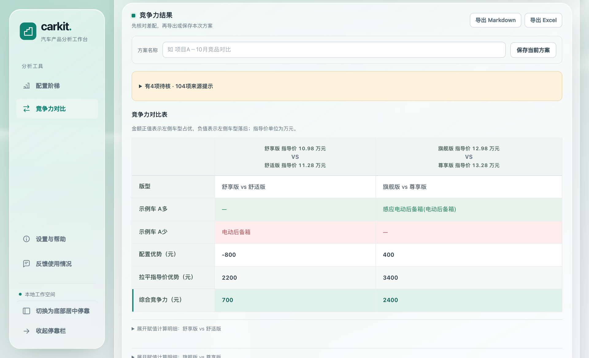

# Carkit · 汽车产品分析工作台

Carkit 是一款车型配置对比工具。想知道同一款车的高配多了什么，或者两款车看起来价格接近、配置差在哪，都可以用它来整理。程序还能按你的计价规则把差异折成金额，再把两车的价格差一起算进去。

- **看同一车系的不同版本（版型）**：从汽车之家读取配置，选一个版本作基准，看其他版本多了什么、少了什么、还能选装什么。
- **对比两款车**：导入本品配置 PPT 或手动录入，选定两侧版型并按统一规则赋值；也可以比较两款竞品。
- **交付或复用结果**：导出 Markdown、Excel，或保存对比方案，下次接着改。

第一次打开时，只想看一款车就从「配置阶梯」开始；手里已有本品配置 PPT，就先用「本品配置导入」。下面的界面截图使用虚构车型，价格和配置仅用来演示。

## 下载与安装

从 [GitHub 最新正式发布页](https://github.com/a18012239736-rgb/carkit/releases/latest) 的 **Assets（附件）** 选择对应文件。`<版本>` 会显示为实际版本号。

| 电脑 | 下载文件 | 怎么用 |
| --- | --- | --- |
| Windows x64，日常使用 | `carkit-<版本>-setup.exe` | 双击安装。后续可以在程序内下载并安装更新。 |
| Windows x64，免安装 | `carkit-<版本>.exe` 或 `carkit.exe` | 双击运行。更新时下载并启动新版 EXE。 |
| Mac，Apple 芯片（M 系列） | `carkit-<版本>-macos-arm64.dmg` | 打开 DMG，把 `carkit.app` 拖入「应用程序」。 |
| Mac，Intel 芯片 | `carkit-<版本>-macos-x86_64.dmg` | 打开 DMG，把 `carkit.app` 拖入「应用程序」。 |

不知道 Mac 用哪种芯片时，打开「 → 关于本机」，查看「芯片」或「处理器」。发布的 macOS 包尚未经过 Apple 公证；如果公司设备限制安装，请联系管理员。

使用安装包无需另外安装 Python。Windows 界面依赖 **WebView2 Runtime**；在线读取汽车之家配置需要 **Edge 或 Chrome**，可在「设置与帮助」点击「检测浏览器可用性」。程序默认使用桌面上的 `Codex` 文件夹，实际路径也可在「设置与帮助」查看。

## 配置阶梯


1. **选车。** 在「配置阶梯」输入车型名称、车系编号或汽车之家配置页网址，点击「搜索车型」。按提示选择车系；出现「选择抓取条件」时，选好年款等条件后点击「开始抓取」。已有记录时，也可以直接点击「打开历史车型」。
2. **确认读到的配置。** 如果汽车之家要求验证，在打开的浏览器里完成验证，等配置表加载后回到程序，点击「验证后继续读取」。需要逐项核对时，点击「查看完整配置」。
3. **选输出和比较基准。** 在「确认版型与比较基准」勾选要输出的版型，再选择「基本版型」和后续版型各自的比较基准。例如，舒适型可以与基础型比较，高配型可以与舒适型比较。也可以让多个版型都和同一个基准比较。
4. **查看或导出。** 在「预览与导出」点击「查看配置阶梯图」。卡片顶部是指导价（万元），下面按所选基准列出配置增加和取消，选装单列。点击「导出配置阶梯 Markdown」或「导出 Excel」保存结果。

如果不想在结果里看到某些项目，展开「不展示的配置」，搜索或按分类勾选，再点击「保存不展示清单」。同一工作目录里的车型共用这份清单；阶梯图及两种导出格式一起生效，原始配置和竞争力赋值不受影响。已生成的结果需重新查看或导出。

版型太多时，可拖动窗口底部的「左右查看」滑杆。阶梯图的卡片还可以左移或右移，只调整当前显示位置；要改变导出的比较关系，请回到版型设置。

## 竞争力对比



「本品」是你正在评估的车型，「竞品」是拿来作参照的车型。没有本品资料时，也可以直接拿两款已经读取过的车型互相比。

1. **准备车型。** 竞品可从「配置阶梯」抓取后复用。要比较本品，在「本品配置导入」点击「导入本品PPT…」或「手动添加本品配置」。如果导入 PPT，先选配置阶梯页，再点「解析这一页」。核对版型、价格口径和继承关系，点「展开为完整配置，进入核对」，检查完整配置并勾选确认后，点「确认并保存本品配置」。指导价以万元填写，例如 `11.98`；标为 TP 价格或未确定的价格不会直接当作指导价使用。
2. **选择左右侧。** 在「竞争力对比」选择「本品 vs 竞品」或「竞品 vs 竞品」，左侧是要判断的车型，右侧是参照。可用「修改本品配置」或「修改竞品配置」补充和更正数据，保存修正后再对比。
3. **手动配对。** 选择双方要比较的版型；用「添加配对组」一次比较多组。要算拉平底价优势，按同一口径填写两边的底价，单位是元，例如 `110000`。底价可以留空，此时仍可看配置优势；两边指导价齐全时也能看拉平指导价优势。
4. **运行并核对。** 点击「开始对比」。先看「待核清单」和「竞争力对比表」，再展开「配置项判定明细」，通过「查看依据」核对原文、标配或选装状态、识别值、人工修正和计价规则。改动配置、配对、价格或规则后，重新运行再导出。
5. **导出或继续做。** 结果可导出 Markdown 或 Excel。填写方案名称并点击「保存当前方案」，可保存本次配置、配对、价格、规则和结果；下次从「打开已保存方案」载入独立工作副本，再修改或另存。

### 怎么读结果

金额为正表示左侧占优，为负表示右侧占优。以上图第一组为例：左侧舒享版少了电动后备箱，按规则少 800 元配置价值；但左侧指导价便宜 3,000 元，填入的底价也便宜 1,500 元。三个数字回答的是不同问题：

| 指标 | 想知道什么 | 图中结果 |
| --- | --- | ---: |
| 配置优势 | 只看配置，左侧多值或少值多少钱？ | −800 元 |
| 拉平指导价优势 | 把指导价差也算进去，左侧还占优吗？ | −800 + 3,000 = 2,200 元 |
| 综合竞争力（拉平底价优势） | 按这次填的底价算，左侧还占优吗？ | −800 + 1,500 = 700 元 |

`✕` 表示没有该配置，`[待定]` 表示还未确认。待定和选装不按标配计入赋值；数量未知、未匹配或没有计价规则的项目，可到「待核清单」检查。

## 赋值规则

在「赋值规则」可调整金额、档位、单位价格和阈值，点「保存并立即应用」后用于后续对比。也可以「从 Excel / JSON 导入…」「保存并导出规则 Excel」或「恢复内置默认值」。灰色项目不纳入本轮计价，原始配置仍可查看。

例如，内置规则中普通电动后备箱计 800 元，标配感应功能额外计 400 元，位置记忆不另加价。修改规则后，实际结果以对比时使用的规则和配置为准。

## 程序更新


程序启动后检查 GitHub 最新正式版，也可在「设置与帮助 → 程序更新」点击「检查更新」。发现版本号更高的正式版才会提示更新；「更新说明」可查看这一版改了什么。

- **Windows 安装版：** 保存工作后点击「下载并安装」。程序会校验发布清单签名和安装包，安装完成后按原工作目录重新打开。
- **Windows 便携版：** 点击「下载新版」。下载完成后保存工作、退出旧版，再运行新版 EXE。想使用程序内安装更新，可以先运行一次 `-setup.exe` 安装版。
- **macOS：** 点击「下载新版」，程序会按芯片选择对应的 DMG。下载完成后点击「打开安装包」，退出旧版，把新版拖入「应用程序」替换。
- **GitHub 无法访问：** 点击「打开飞书更新页」，用有权限的公司飞书账号下载对应系统的安装包。

[查看最新发布与更新日志](https://github.com/a18012239736-rgb/carkit/releases/latest) · [v0.3.3](docs/release-v0.3.3.md) · [v0.3.2](docs/release-v0.3.2.md) · [v0.3.1](docs/release-v0.3.1.md)

## 工作目录与恢复

工作数据保存在本机。换电脑前，可先备份「设置与帮助」显示的整个工作目录；更新时继续使用原工作目录即可。

| 目录 | 内容 |
| --- | --- |
| `raw/` | 汽车之家原始配置和历史车型 |
| `阶梯/` | 竞品配置阶梯及修正副本 |
| `快照/` | 本品配置 |
| `赋值/` | 赋值规则和模板 |
| `方案/` | 保存的对比方案及工作副本 |
| `结果/` | 保存在工作目录中的导出结果 |
| `反馈/` | 本地准备的反馈文字和截图 |
| `回收站/` | 从界面删除后可恢复的文件 |

误删历史车型或本品时，可在 `回收站/` 找到对应文件，将它移回原目录，再刷新列表。

## 反馈与常见问题

- **反馈问题：** 点击侧栏或设置里的「反馈使用情况」。填写标题，描述复现步骤、预期和实际结果，或附截图（最多 3 张 PNG/JPEG，单张不超过 5 MB，合计不超过 10 MB）。点击「准备反馈并前往GitHub」后，在打开的 GitHub 页面核对文字、上传截图，再自行提交。GitHub Issues 公开可见，请先删除截图和文字里的内部资料及个人信息。
- **Windows 打开白屏：** 检查是否安装了 Microsoft Edge WebView2 Runtime。如果提示缺少 `_internal\python312.dll`，从发布页下载当前单文件 EXE 或安装版。
- **找不到车型配置：** 先确认浏览器里已经加载完整配置表并完成网站验证，再回到程序点击「验证后继续读取」。此前抓取过的车型也可以从「打开历史车型」查看。
- **结果里金额不完整：** 先看「待核清单」是否有未确认的配置或缺失规则。拉平指导价和拉平底价分别需要两侧同口径的指导价和底价。

## 本地开发与打包

开发使用 Python 3.12；前端回归检查还需要 Node.js。安装依赖后即可从源码启动或运行测试：

```text
python -m pip install -e ".[gui,scrape,dev]"
python app.py
python -m pytest tests -q
```

需要构建 Windows EXE 或安装器时，见 [Windows 构建指南](docs/windows-dev.md)。GitHub Actions 分别在 Windows、Apple 芯片 Mac 和 Intel Mac 上构建安装包。
