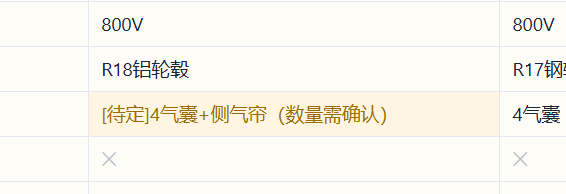
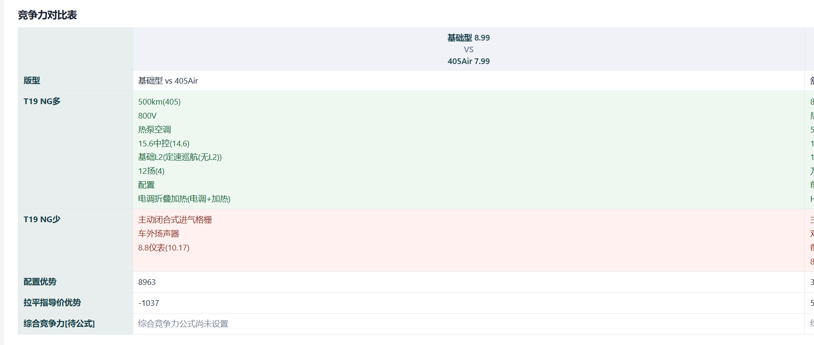

# 产品小工具

产品小工具面向汽车产品和竞品分析工作，覆盖两条流程：从汽车之家读取车型配置并整理成配置阶梯，以及导入本品配置后与历史竞品逐项比较并计算配置优势。

当前版本：**v0.2.1**。本次新增对比方案存取、原文依据与待核清单，并改进配置展示与本品导入，详见[更新日志](docs/release-v0.2.1.md)。

## 下载 Windows 程序

同事无需安装 Python 或了解代码，直接点击下面的链接下载并运行。当前发布包是
**真正的单文件程序**，只需下载 `carkit.exe`，不需要另带 `_internal` 文件夹：

**[下载产品小工具 Windows 程序（最新版本）](https://github.com/a18012239736-rgb/carkit/releases/latest/download/carkit.exe)**

如果直接点击没有开始下载，也可以打开[最新发布页](https://github.com/a18012239736-rgb/carkit/releases/latest)，在 Assets 中下载 `carkit.exe`。仓库 `release` 文件夹中的历史程序不随每次发布更新，请以发布页为准。下载后双击 `carkit.exe` 即可启动。

## Windows 使用

直接运行打包后的 `carkit.exe`。程序会在桌面创建 `Codex` 文件夹保存数据和结果。抓取时需要 Edge 或 Chrome；遇到汽车之家验证，在浏览器完成验证后回到程序点击“验证后继续读取”。

## 第一次使用

1. 在本页顶部下载 `carkit.exe`。
2. Windows 如果显示安全提示，选择“仍要运行”。
3. 双击程序，等待窗口打开。
4. 所有抓取数据、配置快照和导出结果都会保存在桌面的 `Codex` 文件夹中。
5. 程序关闭后再次打开，历史记录会自动保留。

## 配置阶梯

在“配置阶梯”页面输入车型名称、车系编号或汽车之家配置页网址，选择年款并抓取完整配置。选择输出版型，为每个后续版型指定比较基准，检查配置后导出 Markdown。

程序保留汽车之家原始数据，阶梯文档只记录相对基准增加或减少的项目。历史车型可以继续编辑、重新导出或删除；删除的数据会移入工作目录的回收站。

配置阶梯使用不展示清单：清单内的配置一律排除，其他配置沿用原有合并和差异展示规则。展开“不展示的配置”，搜索实际抓取的配置行名，勾选不要的项目，再点击“保存不展示清单”。标注“默认不展示”的项目固定勾选，由默认清单控制；其余项目可勾选添加排除，或取消勾选移出排除清单。同一数据目录的其他车型共用这些排除项。阶梯图、Markdown 和 Excel 使用同一清单，隐藏项对应的选配也一并排除；原始数据及竞争力赋值计算不受影响，已有阶梯需重新查看或导出。

开发时维护不展示配置，只需编辑 `engine/stage_one.py` 顶部唯一的 `DEFAULT_EXCLUDED_ROWS` 清单，在结束括号 `)` 前添加一行汽车之家原始配置行名，保留英文引号和逗号，例如 `'智能香氛',`。清单内的项目始终排除，已有清单保存过的显示选择不再覆盖它；重复添加不会改变结果。要恢复默认项，在代码清单中删除该名称的所有条目；界面另加的排除项可直接取消勾选。保存代码后重启程序，重新查看或导出阶梯即可，无需修改第二个列表、预先升级清单或重新抓取。旧版排除清单自动兼容，额外排除项继续保留。

清单沿用汽车之家原始分类和顺序，每个分类可折叠，并提供“全部不展示”和“取消不展示”；有搜索或不展示项筛选时，分类按钮只操作当前匹配项，取消操作保留固定的默认不展示项。同名配置在各分类中同步勾选。未保存分类的历史数据显示为“未分类（旧数据）”，重新抓取后即可按原分类查看。

### 抓取车型

在“配置阶梯”页面输入车型名称、汽车之家车系编号或配置页网址，年款可以留空以使用最新年款。搜索结果出来后选择正确车系，再选择要读取的版型。程序会保存汽车之家完整配置表，包含未用于阶梯输出的原始行。

### 指定版型关系

第一行作为基础配置。后续版型需要从下拉框选择比较基准，例如“舒适型”相对“基础型”，“高配型”相对“舒适型”。程序只输出相对基准新增或减少的配置，不会把基础配置重复写在每一级。

减少配置不另分组，直接写“当前配置（基准配置）”；整项没有时写“无（基准配置）”，例如“无（主动闭合式进气格栅）”。未变化的子功能只在对应比较项的括号两侧保留。

### 修改和导出

点击“检查配置”后可直接修改配置单元格。常用项目提供下拉选项，也可以选择“自定义填写”。未提及的项目填 `✕`，明确没有配置也填 `✕`，尚未确认填 `[待定]`。确认版型、价格和配置后，点击“导出配置阶梯 Markdown”。

阶梯图或配置表超出窗口宽度时，窗口底部会显示“左右查看”拖动条，无需滚到表格最下面；同时有多张宽表格时，可选择要滚动的区域。

配置校对表会把待定项目用醒目颜色标出，并提供下拉选项：



## 竞争力对比

1. 导入配置阶梯 PPT，或载入已有本品快照。
2. 在完整清单中校对本品配置。未提及的项目按无配置处理，明确待定的项目不参与比较。
3. 选择历史竞品并检查竞品配置。
4. 在当前页面直接修正本品和竞品配置。修正保存到工作副本，不覆盖原始抓取数据。
5. 手动指定版型配对并运行对比。

结果包含 P21 风格竞争力表、配置项判定明细和逐项赋值计算明细，并可导出 Markdown。程序不会按价格自动配对版型。

阶梯图和竞争力表使用统一的配置描述格式，例如“全液晶8.8寸仪表”“外后视镜电调+折叠+加热”“主驾6向电调，副驾4向手调”；座椅材质单独一行。界面、Markdown 和 Excel 同步展示，选配、待定与双方差异仍保留，赋值计算不因文案调整而改变。

结果页支持鼠标拖选文字，按 `Ctrl+C`（Windows）或 `Cmd+C`（macOS）直接复制，无需先导出。粘贴后的表格样式由目标软件决定。

### 导入本品配置

本品通常使用配置策略 PPT 的配置阶梯页。进入“本品配置”或竞争力对比中的“导入本品 PPT”，选择对应页面并解析。程序先识别版型、价格和继承关系，再展开为完整清单。

导入后必须检查完整配置表：

- 下拉框可以填写气囊、激光雷达、轮径与轮圈材质、驾驶辅助、天窗、座椅等项目；
- 需要输入特殊内容时选择“自定义填写”；
- 未提及的清单项目按 `✕` 处理；
- PPT 明确写“待定”的项目保留 `[待定]`，不会参与多/少和金额计算；
- 修改指导价时使用万元，例如 `8.99`。

点击“确认并保存本品配置”后，快照才会出现在竞争力对比的本品列表中。

本品导入支持将“540°透明底盘”（含“540度透明底盘”等写法）识别为540影像。

每个版型的草稿卡片和完整配置表都可填写“选装配置”，每行一项，可填写清单外的选装包或配置描述。正文中明确写“选装”“选配”或“○”的项目也会单独保留；例如“360影像＋选装540°透明底盘”仍以360影像作为标配，540°透明底盘只列为选装。选装按版型独立维护，不随比较基准自动继承；不会覆盖已有标配，也不进入配置多／少和赋值计算。对比结果、Markdown、Excel和保存的方案都会保留这些选装条目。

### 检查竞品配置

选择历史竞品后点击“修改当前竞品配置”。竞品表使用汽车之家抓取和阶梯归一化结果，发现识别错误时可以直接修改。保存的是竞品阶梯副本，原始抓取数据不会被覆盖。

### 指定版型和查看结果

在“版型配对”区域逐组选择本品版型和竞品版型。版型必须人工配对，程序不会按价格或名称自动猜测。运行后可以查看：

- 配置优势：本品多项金额合计减去本品少项金额合计；
- 拉平指导价优势：配置优势加上竞品指导价减本品指导价的差额；
- 综合竞争力（拉平底价优势）：配置优势加上竞品底价减本品底价的差额；
- 每项配置的计价规则和金额；
- 配置项的多、少、同、不计判定。

每个配对组可选填双方底价，单位为元，例如80900。底价只用于本次配对，不修改车型指导价或要求填写所有版型；未填齐底价仍能查看配置优势和指导价拉平结果。双方底价应采用同一政策口径，程序不再重复扣除金融、置换等优惠。Markdown和Excel会保留双方底价及完整计算依据。

发现配置或指导价错误时，先修改并保存本品或竞品配置，再重新运行对比。更改车型、配对、底价或已保存的赋值规则后，旧结果失效，需要重新对比才能导出；更换配对版型会清空对应底价，避免误用上一版型价格。

### 保存和继续对比方案

完成对比后，展开“保存或打开对比方案”，填写名称并保存。方案保存在工作目录的 `方案/` 中，包含本轮双方配置、人工配对、底价、赋值及比较规则、展示偏好、原文依据和结果；每次保存都是另存，不覆盖旧方案。

打开方案会直接显示当时保存的结果，并在 `方案/工作副本/` 创建独立配置副本。可修改副本配置、配对或底价后重新计算，再另存为新方案；原方案、原抓取及当前全局赋值规则不受影响。方案模式固定双方车型和保存的规则，要更换车型或全局规则请先“退出方案，开始新对比”。重算沿用保存的规则，但识别和计算算法使用当前程序版本；历史结果不会自动重算。

### 原文依据与待核清单

对比结果的“配置项判定明细”和待核清单提供“查看依据”，可以同时查看双方原始配置、标配／选配子项、原文识别值、本轮实际采用值、座椅方向等计数说明和现有赋值规则。人工修正与原文识别不同会单独提示；旧文件缺少原表时明确显示无法追溯，不补造来源。已抓取的原始表继续保留，已有竞品缓存会补上对应原文。

待核清单集中提示待定、未映射、数量未知及缺赋值规则等问题；来源缺行属于可展开查看的提示。提示不自动补配置，不改变多／少判定或金额。未发现待核项也不等于已完成人工核实。

竞争力结果示例：



## 配置与赋值规则

程序使用完整配置清单进行比较。汽车之家没有该配置行，按无配置处理；选装配置不作为标配；清单中标记 `/` 的项目不参与比较和赋值。

当前内置规则包括续航、高压平台、轮径与轮圈材质、气囊、影像、辅助驾驶、天窗、座椅、音响、车联网和热泵空调等项目。可在“赋值规则”页面直接修改固定金额、动态档位、单位价格和阈值；保存后后续对比立即使用新规则。也可导入/导出 Excel 或恢复内置默认值。

计算明细会列出每项差异、计价依据、单项金额、多项合计和少项合计，方便复核。金额直接依据双方配置和当前规则计算，不依赖摘要文字；同一项配置互有优劣时按净差计价。

座椅调节的抓取、编辑和计价使用同一套解析规则。前后、靠背、腿托调节各计2向，高低调节按原表注明的方向数计入；选配动作不计入标配方向，腰撑、侧翼等其他调节不计入。阶梯图和竞争力表只显示主副驾方向合计与手调／电调，不展示调节附注；原始数据和选配记录仍保留。主副驾均为手调且未注明方向时，默认主驾6向、副驾4向；电调未注明方向时不猜测方向数。原有每方向50元、每个电调座椅另加400元的默认赋值不变。补齐原表中的方向数后，对比金额可能随之更新。

本品座椅调节的基础选项明确标为“默认手调（主驾6向＋副驾4向）”，不再用“无”表示默认手调。手动配置下拉不再提供“不适用”；程序按动力类型自动判断的不适用状态和历史数据仍保留。

USB未注明数量时，选择“未注明（按基础接口数）”，计算时读取当前赋值规则中的基础接口数（内置为3个）。明确填写的接口数量不会随基础参数调整而改变；历史已存为明确3个的数据也保留3个，可自行改选“未注明”以使用当前规则。

主要气囊按来源标配项计数：主副驾各1个，侧气囊前后排各2个，头部气囊前后排各1个，前排中间气囊1个，膝部每个标配项1个；选配不计，同类别名去重，不预设最低数量。尚未确认数量的特殊气囊保留原始描述，不擅自加入主要项小计。

无线充电保留前后排及明确数量：已标功率≥40W按快充计价并统一显示50W，低于40W显示慢充；未标功率不凭空补写功率，沿用原无线充电单价。空气／魔毯悬架按软硬与高低两项合计，氛围灯只区分单色／多色。

## 工作目录

| 目录 | 内容 |
|---|---|
| `raw/` | 汽车之家原始抓取数据 |
| `阶梯/` | 竞品配置阶梯和编辑副本 |
| `快照/` | 本品配置快照 |
| `赋值/` | 赋值规则模板和文件 |
| `结果/` | 导出的 Markdown 结果 |
| `回收站/` | 删除后可恢复的历史文件 |

运行数据属于使用者本地资料，不应提交到公共代码仓库。

重复抓取或生成结果会保留为独立文件，不覆盖同日历史。配置和规则 JSON 先写入临时文件，写入完成后才替换原文件；保存失败时原文件保留。

## 删除和恢复

配置阶梯历史记录、本品配置和竞品副本都可以在界面中删除。程序采用移入回收站的方式，不会立即永久删除。回收站位于 `Codex\回收站`，需要恢复时可以把对应 JSON 文件移回原目录。

## 常见问题

**提示 `Failed to load Python DLL ... _internal\python312.dll`？** 下载到的是旧的目录版残留 exe，缺少运行库，单独复制该 exe 无法运行。请删除旧文件，从最新发布页重新下载 `carkit.exe`。若最新文件仍报错，检查 Windows 安全中心的“保护历史记录”是否隔离了程序，然后重新下载。

**下载后无法运行？** 先确认下载的是最新发布页的 `carkit.exe`，并在 Windows 安全提示中允许运行。程序需要 WebView2，Windows 10/11 通常已经安装。

**汽车之家页面显示验证？** 在程序打开的浏览器中完成验证，然后回到程序点击“验证后继续读取”。

**为什么出现“不计（待定）”？** 本品或竞品仍有项目标记为 `[待定]`。进入对应配置编辑表，选择具体配置或 `✕` 后重新运行。

**为什么某些配置没有进入比较？** 赋值表中标记 `/` 的项目按规则排除；汽车之家没有该配置行的项目按无配置处理。

**为什么金额显示缺少指导价？** 本品或竞品版型没有填写指导价。配置优势仍可计算，但拉平指导价优势需要双方指导价。

## 开发与测试

项目使用 Python 3.12。开发测试还需要 Node.js（用于前端逻辑回归），打包程序的使用者无需安装。安装依赖后运行：

```powershell
python -m venv .venv
.\.venv\Scripts\Activate.ps1
pip install -e ".[gui,scrape,dev]"
pytest tests -q
```

Windows 打包：

```powershell
powershell -ExecutionPolicy Bypass -File .\build\build_windows.ps1
powershell -ExecutionPolicy Bypass -File .\build\deploy_desktop.ps1
```

单文件打包产物位于 `dist/carkit.exe`，脚本同时会更新 `release/carkit.exe`。桌面部署目录为当前用户的 `Desktop\Codex`。
